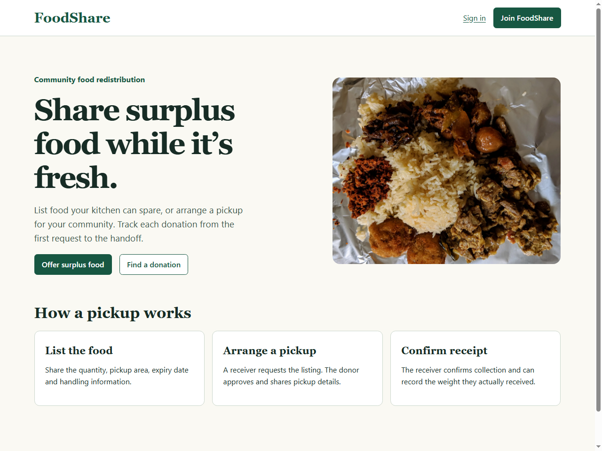

# FoodShare

FoodShare connects kitchens with surplus food to people and organizations that can collect it. Restaurants, grocers and individual donors list an offer. A receiver can reserve it, see pickup instructions after approval, and confirm receipt. That last step gives a pilot organizer evidence of a handoff.



## What works

| Donor | Receiver | Coordinator |
| --- | --- | --- |
| List food, quantity, public area, private pickup instructions, handling information, expiry and an optional photo. | Search by food or area, sort by expiry, reserve an offer and release a reservation. | Review users, listings and requests. Suspend or restore accounts, release reservations and withdraw offers. |
| Review incoming requests, approve a receiver and withdraw available listings. | Confirm an approved collection and optionally record measured kilograms. | Review receipt counts and weight coverage. Export monthly aggregates from the command line. |

One listing represents one indivisible pickup. Dates use the service area's configured time zone. Receivers can browse without JavaScript. The project has local integration-test evidence. Partner participation, production uptime, waste avoided and food-security outcomes require a field pilot.

## Run locally

Use PHP 8.2+ with mysqli/mysqlnd, mbstring and fileinfo, plus an InnoDB database. CI targets MySQL 8.4 and MariaDB 10.11. Use a supported, patched runtime for hosted environments. The local integration suite also exercised MariaDB 10.4.32.

1. Clone this repository. Create an empty database and provision a password-protected account with schema privileges for setup.
2. Using the database client from the repository root, select your database and apply these files **in order**. Existing installations start with the upgrade preflight in the runbook.

   ```sql
   USE foodshare_db;
   SOURCE sql/foodshare_db.sql;
   SOURCE sql/migrations/001_handoffs.sql;
   ```

3. Export `FOODSHARE_DB_USER`, `FOODSHARE_DB_PASSWORD` and, for non-default connections, `FOODSHARE_DB_HOST`, `FOODSHARE_DB_PORT` and `FOODSHARE_DB_NAME` into the PHP process environment. Choose `FOODSHARE_TIMEZONE` for the pickup area. The default is UTC. PHP reads process variables directly.
4. From the repository root run `php -d upload_max_filesize=5M -d post_max_size=6M -S 127.0.0.1:8000 -t public`. Visit [local FoodShare](http://127.0.0.1:8000). Register one donor and one receiver in separate browser profiles to try a handoff.

## Project guide

| Purpose | Start here |
| --- | --- |
| Architecture, baseline findings, priorities, dependencies and five implementation phases | [Audit and roadmap](docs/roadmap.md) |
| Deploy, upgrade, schedule expiry, monitor, restore and release | [Operations](docs/operations.md) |
| Reproduce the integration suite and inspect its coverage | [Verification](docs/verification.md) |
| Pilot protocol, SDGs, evidence and research design | [Impact measurement](docs/impact.md) |
| CV descriptions, demonstration and portfolio materials | [Professional presentation](docs/portfolio.md) |
| Mobile interface | [Registration screenshot](docs/images/registration-mobile.png) |
| Contributions, conduct, security and license | [Contributing](CONTRIBUTING.md) · [Conduct](CODE_OF_CONDUCT.md) · [Security](SECURITY.md) · [MIT](LICENSE) |

`public/` is the web root. `src/` contains web, photo and handoff logic. `config/` opens the database connection. `includes/` holds shared presentation. `sql/` and `bin/` support operators. Uploaded images and SQL scripts belong outside the served tree.
