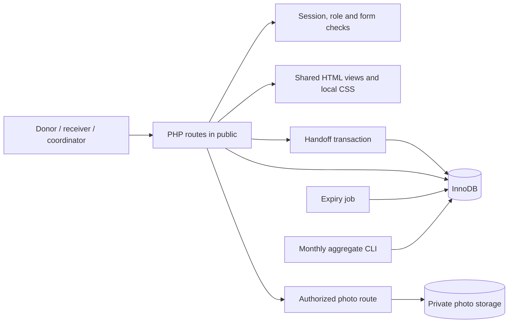
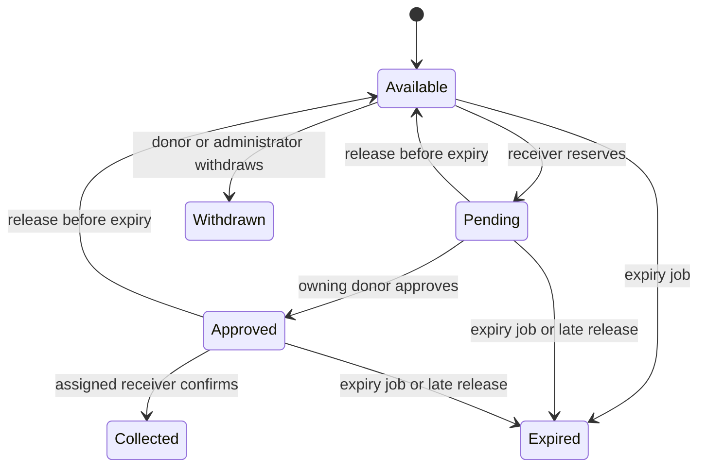

# FoodShare engineering audit and implementation roadmap

## Decision

Build a reliable handoff between a donor and a receiver first. For the pilot, the unit of work is one available listing collected by one receiver. A claim establishes intent, approval gives the receiver pickup instructions, and receipt creates a countable outcome. A donor posting ten trays establishes supply but says nothing about how many reached people. This distinction drives the data model and the evaluation.

The upstream README identifies restaurants, grocers and individuals as donors and NGOs, shelters and individuals as receivers. Its stated purpose is reducing waste by connecting them. The code does not establish adoption, local partner capacity, geography, health benefits or avoided waste. A proposed first segment is a recurring institutional kitchen and a nearby organization with predictable collection capacity. A coordinator can observe both sides and investigate missed pickups. Validate that choice with participants.

## Baseline audit

Audited the complete tracked tree of upstream main at **d612fbf**. The audit covered the PHP routes, configuration, SQL, shared includes, stylesheet, supplied image, README, MIT license and available Git history. The local parent directory was an incomplete export. The work branch descends from the GitHub commit. [Audited revision](https://github.com/pial-paul/FoodShare/tree/d612fbf)

| Original files | What the code actually did | Consequence |
| --- | --- | --- |
| index.php, includes/header.php, includes/footer.php | All three were zero-byte blobs. css/styles.css styled Bootstrap components. Authenticated pages fetched Bootstrap, icons and scripts from CDNs. | No home experience or shared navigation. The only tracked image was img/uploads/food-platter.png, while browse referenced an absent default image. |
| register.php, login.php, logout.php | Public role selection was allowlisted. Registration used password_hash, login used password_verify and prepared SQL. Logout was byte-for-byte identical to login. Registration echoed password values into validation responses. Login duplicated session startup. | Keep modern hash verification and role separation. Repair session lifecycle and password handling. |
| config/config.php | Mixed root database configuration, connection startup, session setup, redirects, SQL escaping and HTML encoding. Connected pages could expose raw connection errors. | Treat form validation, parameter binding, output encoding and error logging as separate responsibilities. |
| donate.php, browse.php | Donors posted quantity, location, date and optional photos. Receiver search had parameterized terms and allowlisted sorts. Upload trusted the client MIME and included the original filename in a served directory. Browse loaded all matches and distinct locations, rendered some fields unescaped and filtered by status alone. | Retain search and posting. Bound result sets, isolate photos, check dates throughout the workflow and keep precise pickup notes private. |
| request.php | Began a transaction, checked availability, inserted a pending request and updated the donation. The initial read did not lock the listing. It also promised a notification without a delivery mechanism. | Concurrent requests could both see the same offer. A transaction by itself did not enforce exclusive assignment. |
| dashboard.php | Per-role counts existed. History, request review and status actions used placeholder links and recent activity had placeholder text. | The README's advertised picked-up workflow could not be completed by a donor and receiver. |
| admin.php | Role-gated user, donation and request management, totals and visual summaries. Deletion cascaded from users/donations. Cancel could reopen an item without a state check. Some error branches exposed database messages. | Preserve oversight. Replace irreversible web deletion and enforce the same reservation rules across roles. |
| sql/foodshare_db.sql | Three related tables, unique email, foreign keys, status enums and a string quantity. Bootstrap dropped tables and seeded an MD5 administrator incompatible with the login verifier. | Keep relational integrity and legacy quantities. Add a data-preserving upgrade, a unique assignment constraint, query indexes and nullable measured mass. |
| README.md, LICENSE and repository root | MIT already specified. Installation referenced a missing config sample. No tracked test suite, CI, deployment configuration, contribution policy or impact dataset. | Retain the license and history. Tie release claims to reproducible evidence. |

## Architecture and state

Users own donations or requests. A donation has many historical requests. A generated request slot is 1 for pending, approved or completed records and NULL for declined ones. A unique index over donation ID and slot permits many released attempts and at most one active or completed assignment. The donation row is locked before changing its request. For a move from pending to approved, the donation itself stays requested. A completed request and picked-up donation are written together. Late reporting of an actual pickup after expiry currently requires coordinator reconciliation outside the app. Decide how frequently that happens before adding a correction workflow.

Keep the server-rendered PHP monolith, MySQL-compatible InnoDB and existing URL names. One relational transaction covers the operational invariant. Use ordinary HTML GET for filters and POST plus CSRF and a 303 redirect for mutations. A JSON API becomes worthwhile when a real partner has a second client. Reuse the transaction service there and add scoped credentials, idempotency keys and contract tests before any integration. Another framework, queue, vector database or microservice adds little to this pilot.

## Prioritized delivery

**Must-have** gates a safe, measurable pilot. **High** addresses a real operational or usability risk before expansion. **Advanced** requires sufficient partner activity and baseline evidence. **Future** requires an external integration, substantial data or a demonstrated unmet need. “Implemented” describes branch code. “Field gate” and “Proposed” require further work. Suggested owners are responsibilities a small team can combine.

### Phase 1 · Critical fixes and foundations

| What and status | Why and expected outcome | How and modules | Priority, dependency and acceptance |
| --- | --- | --- | --- |
| Repair sessions, configuration, roles and form handling. Implemented. | Prevent stale roles, password reflection and unauthenticated mutations. Recover a functioning sign-out. | public/login.php, register.php, logout.php, src/web.php, config/config.php. Fetch the current account, validate role server-side, rotate session ID, bind CSRF to session and throttle failed login attempts by email/peer. | Must-have. First engineering task. Confirm role denial, suspension, logout and 429 behavior in HTTP tests. |
| Preserve historical data and enforce one assignment. Implemented. | A collision wastes a receiver's trip. Destructive bootstrap makes deployment unsafe. | sql/foodshare_db.sql, sql/migrations/001_handoffs.sql, bin/check-upgrade.php, src/handoffs.php. Row lock, unique slot, explicit state transitions and rollback. | Must-have. Preflight and backup precede migration. Race two receivers. Repeated receipt and stale release must preserve the original outcome. |
| Isolate public routes and photos. Implemented. | Keep private configuration and upload contents outside the document root. Preserve legacy image access under authorization. | public/, src/photos.php, public/photo.php, docs/operations.md. Server-derived type, size/dimension checks, opaque new filename, private storage and role-aware image lookup. | Must-have. Requires host web-root change and inspected legacy files. Test upload failure, approved media types and protected retrieval. |

### Phase 2 · UX and core features

| What and status | Why and expected outcome | How and modules | Priority, dependency and acceptance |
| --- | --- | --- | --- |
| Restore navigation, search and usable work queues. Implemented. | Staff should complete the journey on a phone on a weak connection. | public/index.php, browse.php, dashboard.php, public/css/styles.css, includes/. Responsive local CSS, visible form labels, skip link, status text, empty states, filters and 20-item pages. | Must-have. Depends on sessions and valid routes. Screenshots and integration tests cover initial screens and task paths. Partner task observation remains a field gate. |
| Coordinate pickup and evidence. Implemented. | Exact addresses need limited visibility. Approving a pickup and receiving it are different events. | public/donate.php, request.php, dashboard.php, src/handoffs.php. Collect public area, private instructions and handling details. Record receiver-confirmed time and optional measured kg. | Must-have. Requires migration. Accept only the assigned receiver's confirmation after donor approval. Never infer mass from free text. |
| Release, withdraw and moderate reversibly. Implemented. | A cancellation should free eligible stock and preserve history. | public/admin.php, src/handoffs.php. Suspend or restore accounts, withdraw inventory and release the current reservation. Provide reviewable user, donation and request lists. | High. Depends on state machine. Confirm completed pickups cannot be reopened and suspended accounts lose access. |
| Improve pilot pickup windows, verified partner onboarding and incident handling. Proposed. | A date alone can hide a kitchen closing in an hour. Staff need a named route for a failed or unsafe handoff. | Interview operators first. Add pickup_start/end with service zone, organization verification by coordinator, and structured issue reasons with minimal private notes. Extend public/donate.php, dashboard.php, admin.php and migration 002. Add a donor correction path before any reservation. | High after interviews, must-have before unsupervised public operation. Pilot lead owns acceptance. Rehearse late pickup, refusal, no-show and coordinator escalation with both partners. |
| Validate access and language. Field gate. | A labeled form can still fail for a screen-reader user or a volunteer unfamiliar with the interface language. | Observe offer, search, release and confirmation tasks with keyboard, screen reader, small screen and slow connection. Fix public/css/styles.css and views. Add translated labels only for languages partners actually request. | High after working core. Record task completions, abandonment, assistance and retest findings in docs/verification.md. |

### Phase 3 · Advanced features and intelligent capabilities

| What and status | Why and expected outcome | How and modules | Priority, dependency and acceptance |
| --- | --- | --- | --- |
| Expiry-first discovery and deadline cleanup. Implemented. | Surface time-sensitive inventory and remove stale reservations without staff intervention. | public/browse.php, bin/expire.php, status/expiry index. Earliest expiry then ID is a deterministic baseline. Recheck eligibility at mutation time. | High after Phase 1. Verify expired food cannot be approved and cleanup is repeatable. |
| Explainable matching. Proposed experiment. | A candidate receiver needs time, capacity and access to transport. Short geographic distance alone can be misleading. | Start with voluntary pickup windows, broad service areas, capacity and storage constraints. Filter ineligible candidates first, then rank eligible offers by expiry and usable pickup time. Show the reason and allow ordinary browse. Create src/Matching.php, a migration for preferences and tests with consented or synthetic fixtures. | Advanced, after structured windows and enough eligible choices. Compare to expiry-first on completed eligible handoffs, time to claim, travel burden and concentration by partner. Retire if no meaningful gain. |
| Targeted reminders. Proposed. | A reminder is valuable only if missed pickups are common. | Record reason and timing of failed collections first. If supported, add opt-in preferences, transactional outbox keyed by event/recipient, bounded retry, unsubscribe and a delivery log. Keep private pickup notes out of message previews. Proposed src/Notifications.php and bin/send-reminders.php. | Advanced. Requires partner consent, a channel and actual missed-pickup evidence. Test duplicate delivery prevention and measure no-show rate against the baseline. |
| Predictive demand or expiry-risk model and partner API. Conditional. | Decide whether forecasts improve staffing or a partner integration saves duplicate entry. | For ML, use time-split evaluation by partner and period, aggregate features, a simple frequency baseline and shadow-mode decisions. Record calibration, drift and who can be disadvantaged. For API, implement the scoped interface described above in public/api/v1/ only upon partner demand. | Future. Require representative longitudinal data, permission, a second client for the API, and an explicit go/no-go decision per feature. No individual eligibility scoring or autonomous food-safety judgment. |

### Phase 4 · Verification, optimization and deployment

| What and status | Why and expected outcome | How and modules | Priority, dependency and acceptance |
| --- | --- | --- | --- |
| Regression tests, CI and diagnosable failures. Implemented locally, hosted checks require a run. | A green landing page can conceal broken reservations. | tests/handoffs.test.mjs, .github/workflows/ci.yml, src/web.php. Test original-schema migration and isolated HTTP clients, record reference IDs on internal errors. Matrix runs PHP syntax and integration checks. | Must-have before release, tests begin in Phase 1. Require checks against the intended merge commit on both configured database engines. |
| Stage, secure and recover. Runbook implemented, host work pending. | Recoverability, private media persistence and correct HTTPS settings affect every real participant. | docs/operations.md and SECURITY.md. Serve public/ only, inject secrets, isolate DB, verify private media and take coordinated backups. Run a restore drill, review access and document retention and incident ownership. | Must-have before real partner data. Operator provides staging evidence and recovery measurements. Deployment is outside this delivery at the owner's request. |
| Scale based on measurements. Partly implemented. | Unbounded browse and admin reads used to grow with the database. | Bounded lists and indexes in browse.php, admin.php, dashboard.php and migration 001. Next run EXPLAIN and p95 load tests on realistic distributions. Leading-wildcard search and large OFFSETs still cost work. Adopt normalized area IDs, a keyset cursor or full-text search only where plans justify them. | High after partner volume estimate. Set a latency target with the partner, publish workload and raw results. Add shared sessions and photo storage before multiple web workers on separate hosts. |

### Phase 5 · Evidence, documentation and professional presentation

| What and status | Why and expected outcome | How and modules | Priority, dependency and acceptance |
| --- | --- | --- | --- |
| Record measured receipts and report coverage. Implemented. | Listings cannot establish redistribution, and missing mass can bias reports. | bin/impact-report.php and public/admin.php. Count dated completions, count weighed ones, sum measured kg and group monthly by UTC receipt time. | Must-have after receipt flow. Verify a repeat, an unweighed handoff and a dated report in the suite. |
| Run a partner-led pilot and publish a redacted evaluation. Proposed. | Establish whether the process solves a local bottleneck and whether uptake persists. | Follow docs/impact.md. Appoint a coordinator, record a baseline, reconcile receipt records, log refusals, agree privacy and publish data limitations. Create docs/pilot-report.md only when observations exist. | High after release gates and partner agreement. Partner reviews the written interpretation and independently checks a sample. |
| Present reproducible engineering work. Starter materials implemented. | Reviewers can inspect design decisions, verification and individual contribution. | README, screenshots, architecture diagram, test guide, policy files, change log and docs/portfolio.md. Add a short captioned synthetic demo and an actual release permalink after review. | High after CI and owner review. For applications, distinguish personally owned work, AI-assisted implementation, plans, observations and estimates. |
| Publish lessons or collaborate on research. Proposed. | A reproducible negative result is valuable to scholarship, engineering and entrepreneurship audiences. | With consent, publish the evaluation method and aggregate findings. Submit a focused documentation/test contribution to a relevant open-source community only when a reusable issue exists. For a venture assessment, count coordinator minutes, pickup costs and repeat participation per period. | Future after pilot. Secure partner permission, authorship and data-sharing agreement before publication. |

## Pilot decision

Proceed to a supervised pilot when two independent roles can complete a staging pickup, an operator can restore recorded evidence and media, partners have rehearsed a missed pickup, and everyone agrees who can stop distribution. Review the pilot against partner-defined thresholds for completed handoffs, burden, reliability and refusals. Stop or redesign if the software increases coordination work, concentrates access in one organization or pushes staff to accept unsuitable food. Expand one area or donor type at a time.
